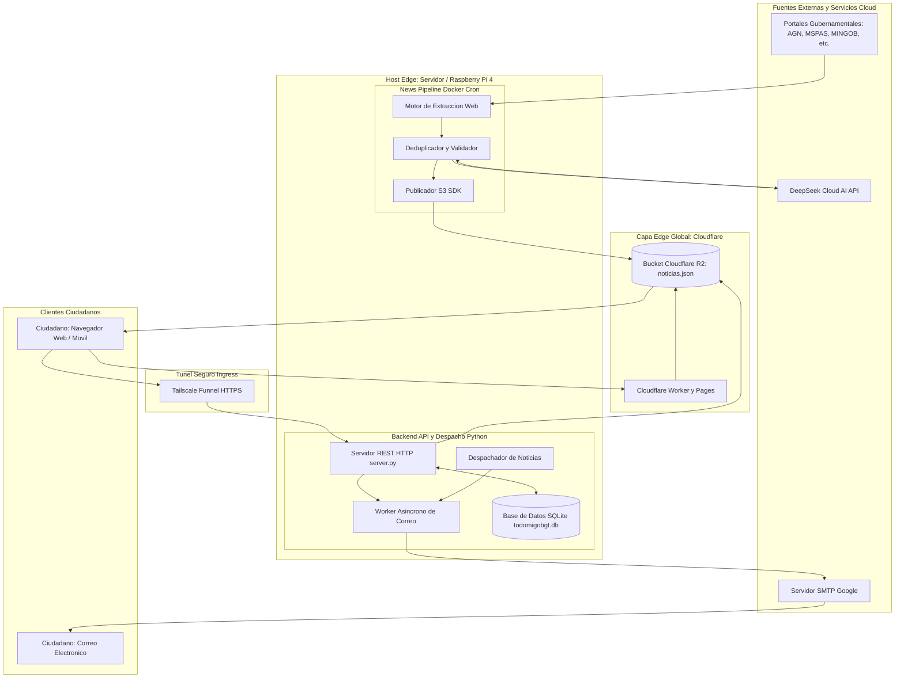

# TODOMIGOBGT: Plataforma Civica Unificada y Sistema de Alertas Ciudadanas de Guatemala

[](CHANGELOG.md)
[](LICENSE)
[](CONTRIBUTING.md#2-modelo-de-ramas-git-flow-formal)
[](https://conventionalcommits.org)
[](https://semver.org)

---

## 1. Resumen Ejecutivo

TODOMIGOBGT es una solucion tecnologica de gobernanza digital y codigo abierto disenada para centralizar, sintetizar y democratizar el acceso a la informacion publica oficial, tramites y convocatorias ciudadanas de la Republica de Guatemala.

El sistema aborda la fragmentacion y complejidad tecnica del ecosistema de portales gubernamentales tradicionales, el cual frecuentemente dificulta el acceso oportuno de la ciudadania a convocatorias sociales, alertas tempranas de emergencia, servicios de salud y programas de educacion, con especial enfasis en la inclusion de comunidades mayahablantes mediante soporte bilingue en idioma K'iche'.

La arquitectura implementa un modelo de procesamiento desacoplado de alta disponibilidad y bajo coste operacional:
1. **Frontend en el Edge:** Publicado sobre la red perimetral de Cloudflare (Workers y Pages) con almacenamiento de objetos distribuido (R2).
2. **Pipeline Inteligente ETL:** Extraccion modular de fuentes oficiales y procesamiento de lenguaje natural asistido por IA (DeepSeek).
3. **Backend Perimetral de Notificaciones:** Sistema ligero en hardware embebido (Raspberry Pi 4) o servidores virtuales, expuesto mediante tunel cifrado (Tailscale Funnel) con persistencia transaccional SQLite WAL y envio transaccional SMTP.

---

## 2. Arquitectura Global del Sistema



---

## 3. Componentes del Repositorio

El proyecto esta organizado bajo una arquitectura monorepositorio que separa responsabilidades operacionales:

| Modulo / Directorio | Tecnologia | Proposito |
| :--- | :--- | :--- |
| `todo-mi-gob-gt/` | Astro 5, Tailwind CSS, TypeScript | Portal web ciudadano, responsive, bilingue (Español / K'iche'), accesible (WCAG 2.1 AA) y ejecutable en Cloudflare Workers. |
| `news-pipeline/` | Node.js 20, TypeScript, Vitest, Docker | Pipeline ETL para scraping de portales gubernamentales, filtrado y traduccion con IA (DeepSeek) y publicacion S3 a Cloudflare R2. |
| `raspberry-pi/` | Python 3.12, SQLite WAL, SMTP | Backend REST nativo para suscripciones ciudadanas, base de datos de usuarios y despacho de correos en segundo plano. |
| `.github/workflows/` | GitHub Actions, Docker Buildx | Automatizacion de integracion continua y publicacion de imagenes multi-arquitectura (ARM64 / AMD64). |

---

## 4. Control de Versiones y Metodologia de Desarrollo

El proyecto opera bajo estandares rigurosos de ingenieria de software y gestion de versiones para codigo abierto:

### 4.1 Git Flow Formal

* **`main`**: Rama de produccion estricta. Todo commit en `main` representa una version estable y debe estar acompanado de una etiqueta de version semantica (`vX.Y.Z`).
* **`develop`**: Rama de integracion para consolidacion de funcionalidades previas a liberacion.
* **`feature/<nombre>`**: Ramas temporales para desarrollo de nuevas capacidades. Se ramifican de `develop` y se fusionan mediante Pull Request a `develop`.
* **`refactor/<nombre>`**: Ramas destinadas a reestructuracion y mejoras internas sin cambios funcionales.
* **`hotfix/<nombre>`**: Ramas para mitigacion de incidentes criticos en produccion, ramificadas desde `main` y reintegradas a `main` y `develop`.

Para mas detalles del flujo, consulta la [Guia de Contribucion](CONTRIBUTING.md).

### 4.2 Conventional Commits 1.0.0

Los mensajes de confirmacion deben seguir la especificacion formal:
* `feat`: Nuevas funcionalidades del sistema.
* `fix`: Correcciones de defectos.
* `refactor`: Refactorizaciones de codigo sin impacto funcional.
* `docs`: Modificaciones en documentacion tecnica.
* `test`: Adicion o refactorizacion de pruebas unitarias/integracion.
* `chore`: Mantenimiento de dependencias y configuracion.

### 4.3 Versionado Semantico (SemVer 2.0.0)

El versionado de la plataforma sigue el esquema `MAJOR.MINOR.PATCH`:
* **MAJOR**: Cambios arquitecturales o roturas de compatibilidad en la API/modelo de datos.
* **MINOR**: Incorporacion de nuevas fuentes de datos o capacidades funcionales compatibles hacia atras.
* **PATCH**: Parches de seguridad, optimizaciones de rendimiento y correcciones menores.

---

## 5. Instalacion y Despliegue

### 5.1 Requisitos Previos

* Node.js 20 LTS o superior
* Gestor de paquetes `pnpm` (`npm install -g pnpm`)
* Python 3.10 o superior
* Docker Engine y Docker Compose
* Cuenta y credenciales de Cloudflare (Workers y R2)
* Cuenta de API DeepSeek
* Cuenta Tailscale (para despliegue perimetral seguro)

### 5.2 Clonacion del Repositorio

```bash
git clone https://github.com/Trebol4Devop/todomigobgt.git
cd todomigobgt
```

### 5.3 Modulo 1: Frontend (`todo-mi-gob-gt`)

1. **Instalacion de dependencias:**
   ```bash
   cd todo-mi-gob-gt
   pnpm install
   ```

2. **Configuracion de entorno (`.env`):**
   ```ini
   PUBLIC_API_URL=https://tu-nodo-tailscale.ts.net
   ```

3. **Compilacion local y prueba:**
   ```bash
   pnpm run dev
   ```

4. **Despliegue en Cloudflare Workers:**
   ```bash
   npx wrangler login
   pnpm run build
   npx wrangler deploy
   ```

### 5.4 Modulo 2: Pipeline de Noticias (`news-pipeline`)

1. **Configuracion de variables (`.env`):**
   ```ini
   NODE_ENV=production
   LOG_LEVEL=info
   DEEPSEEK_API_KEY=tu_api_key
   DEEPSEEK_BASE_URL=https://api.deepseek.com
   DEEPSEEK_MODEL=deepseek-chat
   R2_ACCOUNT_ID=tu_account_id
   R2_ACCESS_KEY_ID=tu_access_key
   R2_SECRET_ACCESS_KEY=tu_secret_key
   R2_BUCKET_NAME=todomigobgt
   R2_OBJECT_KEY=noticias.json
   SCRAPER_MAX_CANDIDATES=30
   SCRAPER_TIMEOUT_MS=15000
   SCRAPER_DELAY_MS=1000
   DRY_RUN=false
   OUTPUT_PREVIEW_PATH=./output/noticias.preview.json
   ```

2. **Ejecucion de pruebas automatizadas:**
   ```bash
   cd news-pipeline
   pnpm install
   pnpm test
   ```

3. **Ejecucion en contenedor Docker:**
   ```bash
   docker build -t todomigobgt-news-pipeline .
   docker run --rm --env-file .env -v $(pwd)/output:/app/output todomigobgt-news-pipeline
   ```

### 5.5 Modulo 3: Backend de Suscripciones y Notificaciones (`raspberry-pi`)

1. **Configuracion de variables (`.env`):**
   ```ini
   HOST=0.0.0.0
   PORT=8080
   DB_PATH=/app/data/todomigobgt.db
   SMTP_HOST=smtp.gmail.com
   SMTP_PORT=465
   SMTP_USER=tu_correo@gmail.com
   SMTP_PASS=tu_contrasena_de_aplicacion
   SMTP_APP_NAME=todomigobgt
   SENDER_NAME=TODOMIGOBGT Alertas Ciudadanas
   R2_NOTICIAS_URL=https://pub-b246f9594b0f4cb5960b8f6ec9f1ba2b.r2.dev/noticias.json
   ```

2. **Ejecucion de pruebas de base de datos y mensajeria:**
   ```bash
   cd raspberry-pi
   python test_database.py
   python test_mailer.py
   ```

3. **Ejecucion mediante Docker Compose:**
   ```bash
   docker compose up -d --build
   ```

4. **Publicacion segura mediante Tailscale Funnel:**
   ```bash
   sudo tailscale up
   sudo tailscale funnel 8080
   tailscale funnel status
   ```

---

## 6. Especificacion de API REST

El backend expone los siguientes endpoints REST:

### `GET /api/health`
Retorna el estado de disponibilidad del servicio y conexion a la base de datos.
* **Respuesta exitosa (`200 OK`):**
  ```json
  {
    "status": "ok",
    "service": "todomigobgt-raspi",
    "db": "todomigobgt.db"
  }
  ```

### `GET /api/categories`
Lista el catalogo oficial de categorias tematicas de alertas.
* **Respuesta exitosa (`200 OK`):**
  ```json
  [
    { "id": "education_scholarships", "name": "Educacion y Becas" },
    { "id": "health_wellbeing", "name": "Salud y Prevencion" },
    { "id": "social_programs", "name": "Apoyo Social" },
    { "id": "procedures_services", "name": "Tramites y Documentos" },
    { "id": "security_alerts", "name": "Alertas y Emergencias" },
    { "id": "employment_development", "name": "Empleo y Emprendimiento" }
  ]
  ```

### `POST /api/users`
Registra un nuevo ciudadano o actualiza sus categorias suscritas.
* **Cuerpo de la solicitud:**
  ```json
  {
    "name": "Maria Alvarez",
    "email": "maria@ejemplo.gt",
    "preferences": ["health_wellbeing", "education_scholarships"],
    "allow_update": true
  }
  ```
* **Respuesta exitosa (`201 Created`):**
  ```json
  {
    "id": 1,
    "name": "Maria Alvarez",
    "email": "maria@ejemplo.gt",
    "is_new": true,
    "preferences": ["health_wellbeing", "education_scholarships"]
  }
  ```

### `POST /api/news/dispatch`
Recibe un lote de noticias procesadas y despacha las alertas a los usuarios suscritos en segundo plano.

---

## 7. Documentacion Adicional

* [Guia Completa de Despliegue e Infraestructura](GUIA_DESPLIEGUE.md)
* [Guia de Contribucion y Git Flow](CONTRIBUTING.md)
* [Codigo de Conducta](CODE_OF_CONDUCT.md)
* [Politica de Seguridad](SECURITY.md)
* [Registro Historico de Versiones](CHANGELOG.md)

---

## 8. Licencia

Este proyecto esta licenciado bajo los terminos de la [Licencia MIT](LICENSE). Toda persona u organizacion es libre de utilizar, estudiar, modificar y distribuir esta solucion con fines publicos o privados con la debida atribucion.
